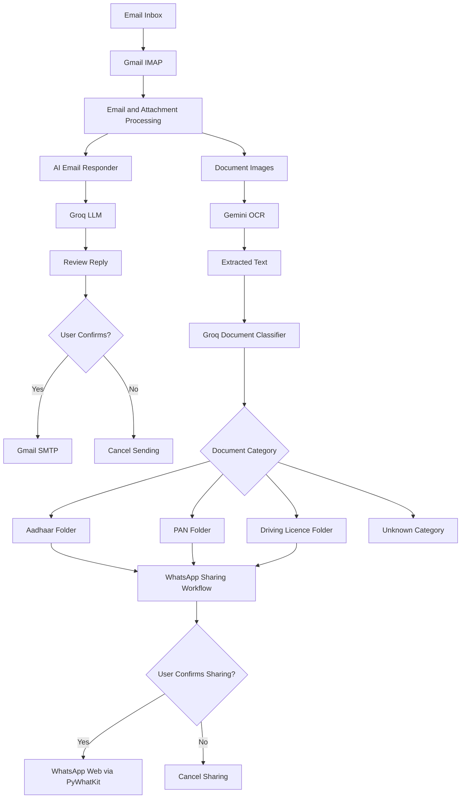

# AI Email Reader & Auto Responder with File Intelligence

An AI-powered email automation and document intelligence system that combines email processing, intelligent reply generation, document OCR, document classification, and WhatsApp-based reporting in a single Python project.

## Overview

Managing emails and processing document attachments manually can be repetitive and time-consuming. This project explores how Large Language Models (LLMs), OCR, and workflow automation can simplify these tasks.

The system can retrieve unread emails, generate context-aware reply drafts, extract text from document images, classify identity documents, organize files into dedicated folders, and share document-related updates through WhatsApp—with user confirmation before sending replies or sharing sensitive files in the relevant workflows.

## Key Features

- **AI Email Assistant:** Fetches unread emails through Gmail IMAP and extracts sender, subject, and message content.
- **AI-Powered Reply Generation:** Uses Groq-hosted language models to draft relevant, professional email replies.
- **Human-in-the-Loop Email Sending:** Displays the proposed reply and requires confirmation before sending it.
- **Document OCR:** Uses Google's Gemini API to extract text from document images.
- **Intelligent Document Classification:** Uses an LLM to categorize supported documents into Aadhaar, PAN, Driving Licence, or unknown categories.
- **Automated File Organization:** Moves classified documents into dedicated folders and avoids overwriting files with the same name.
- **WhatsApp Integration:** Uses PyWhatKit to share selected document images and processing summaries through WhatsApp after confirmation.
- **Interactive AI Chatbot:** Provides a terminal-based conversational assistant powered by the Groq API.
- **Environment-Based Configuration:** Uses environment variables to separate credentials and configuration from application code.

## Technology Stack

| Category | Technologies |
|---|---|
| Programming language | Python |
| Large Language Models | Groq API, Gemini API |
| Generative AI | Prompt engineering, LLM-based text generation and classification |
| OCR and image processing | Gemini, Pillow |
| Email integration | IMAP, SMTP, Python `email` library |
| Messaging automation | PyWhatKit, WhatsApp Web |
| Configuration and secrets | `python-dotenv`, environment variables |
| Version control | Git, GitHub |

## System Architecture



*Architecture overview of the main workflows. The email responder, document processor, WhatsApp integration, and chatbot are implemented as separate Python scripts.*

## Project Structure

```text
email_llm_assistant_groq_ready/
│
├── autoresponse.py
│   └── Fetches unread emails, generates replies, and sends
│       them after user confirmation.
│
├── chatbot.py
│   └── Interactive terminal-based AI chatbot.
│
├── doxprocessing.py
│   └── OCR, document classification, and file organization.
│
├── mail_dox_whatsapp.py
│   └── Email attachment processing, document classification,
│       and optional WhatsApp reporting.
│
├── whatsappchatbot.py
│   └── Additional WhatsApp-related script.
│
├── requirements.txt
│   └── Python dependencies.
│
├── .env.example
│   └── Example environment configuration (create this file).
│
├── .gitignore
│   └── Excludes credentials, local environments, and
│       private document folders from Git.
│
└── README.md
    └── Project documentation.
```

## How It Works

### 1. Email Reading and AI Response

1. Connects to the configured email server using IMAP.
2. Retrieves unread emails and extracts relevant message details.
3. Sends the email context to a Groq-hosted language model.
4. Generates a concise, professional reply.
5. Displays the draft for review.
6. Sends the reply through SMTP only after the required user confirmation.

### 2. Document Intelligence

1. Retrieves supported image attachments from email.
2. Uses Gemini to extract readable text from document images.
3. Passes the extracted text to a language model for document classification.
4. Assigns a supported document category.
5. Organizes the file into its corresponding local folder.
6. Handles duplicate filenames to reduce accidental overwriting.

### 3. WhatsApp Reporting

1. Processes and classifies supported document images.
2. Prepares a document-processing summary.
3. Requests confirmation before sharing selected images and the summary.
4. Uses PyWhatKit and WhatsApp Web to initiate the sharing workflow.

**Note:** WhatsApp automation may require an authenticated WhatsApp Web session, a running browser, and a suitable desktop environment.

### 4. Interactive Chatbot

The chatbot maintains conversational message history during the running session and sends messages to a Groq-hosted language model to generate responses.

## Getting Started

### Prerequisites

- Python 3.10 or a compatible Python version.
- A Gmail account with IMAP access enabled.
- A Google Gemini API key.
- A Groq API key.
- WhatsApp Web access for the optional messaging workflow.
- An internet connection.

### 1. Clone the Repository

```bash
git clone https://github.com/Vansh-1702/AI-Email-Reader-Auto-Responder-with-File-Intelligence.git
cd AI-Email-Reader-Auto-Responder-with-File-Intelligence
```

### 2. Create a Virtual Environment

**Windows PowerShell**

```powershell
python -m venv .venv
.\.venv\Scripts\Activate.ps1
```

If PowerShell blocks virtual environment activation, use Command Prompt or resolve the local execution-policy issue according to your organization's security settings.

### 3. Install Dependencies

```bash
python -m pip install --upgrade pip
pip install -r requirements.txt
```

Ensure `requirements.txt` includes all packages used by the scripts, including `groq`, `python-dotenv`, `Pillow`, `google-generativeai`, and `pywhatkit`, where applicable.

### 4. Configure Environment Variables

Create a local `.env` file in the project root. Use the following template:

```dotenv
# Gmail configuration
EMAIL_ADDRESS=your_email@gmail.com
APP_PASSWORD=your_gmail_app_password
IMAP_SERVER=imap.gmail.com
IMAP_PORT=993
SMTP_SERVER=smtp.gmail.com
SMTP_PORT=587

# AI API credentials
GEMINI_API_KEY=your_gemini_api_key
GROQ_API_KEY=your_groq_api_key

# Model configuration
GEMINI_MODEL=gemini-2.0-flash
GROQ_MODEL=openai/gpt-oss-120b

# Optional WhatsApp recipient
WHATSAPP_NUMBER=+91XXXXXXXXXX
```

The model names above are example defaults. Use model identifiers currently supported by your API accounts and ensure they match the configuration expected by each script.

**Important:** The `.env` file is local configuration and must never be committed to GitHub. The `.env.example` file should contain placeholders only, never real credentials.

For Gmail, use an appropriately configured Google App Password where required. Do not use your regular Gmail account password.

### 5. Run the Applications

Run commands from the project root after activating the virtual environment.

**Interactive AI chatbot**

```bash
python chatbot.py
```

**AI email auto responder**

```bash
python autoresponse.py
```

**Standalone document processor**

```bash
python doxprocessing.py "path/to/document.jpg"
```

Replace the example image path with the path to an actual supported image.

**Email attachment, document intelligence, and WhatsApp workflow**

```bash
python mail_dox_whatsapp.py
```

The email and WhatsApp workflows may require user interaction and valid account configuration. Review the prompts before approving any external communication.

## Security and Responsible Use

This project handles potentially sensitive emails and identity documents. The following precautions are important:

- Store API keys and email credentials in environment variables, not source code.
- Keep `.env`, virtual environments, private attachments, and identity-document folders out of Git.
- Revoke and replace any API key or password that has been exposed.
- Review AI-generated email replies before sending them.
- Share identity documents through WhatsApp only when necessary and explicitly authorized.
- Avoid logging or displaying sensitive OCR output unnecessarily.
- Treat email content and extracted document text as untrusted input.
- Use test accounts and non-sensitive sample documents during development.
- Remember that `.gitignore` does not remove secrets that were committed previously.

## Limitations

- OCR quality depends on image resolution, orientation, lighting, and document clarity.
- LLM-generated replies and classifications can be inaccurate and require appropriate review.
- Email access depends on account permissions, server connectivity, and authentication configuration.
- WhatsApp automation depends on browser state, login status, and the behavior of the messaging service.
- The scripts are separate command-line workflows rather than a unified web application.
- The project does not, by itself, establish production-grade security, reliability, or compliance for handling identity documents.

## Future Improvements

- Build a unified web interface using FastAPI and a frontend framework.
- Add a searchable database for email history and document metadata.
- Introduce automated tests and structured application logging.
- Add retry handling, rate-limit management, and more robust error recovery.
- Improve classification with confidence scores and a manual review queue.
- Add asynchronous task processing for large attachment volumes.
- Introduce role-based access control and encrypted storage for sensitive documents.
- Add evaluation datasets to measure OCR quality, classification accuracy, and response relevance.
- Package the application using Docker for reproducible deployment.

## Skills Demonstrated

- Python application development and modular scripting.
- Integration of third-party APIs and LLM services.
- Prompt engineering and LLM-based classification.
- OCR-based document processing.
- Email protocol integration using IMAP and SMTP.
- Workflow automation and file-system operations.
- Environment-based secret management.
- Git, GitHub, and project documentation.

## Author

**Vansh Verma**  
B.Tech — Computer Science and Engineering (Data Science)

GitHub: [Vansh-1702](https://github.com/Vansh-1702)

## License

No license has been specified yet. If you intend to make this project open source, add an appropriate `LICENSE` file and update this section.
